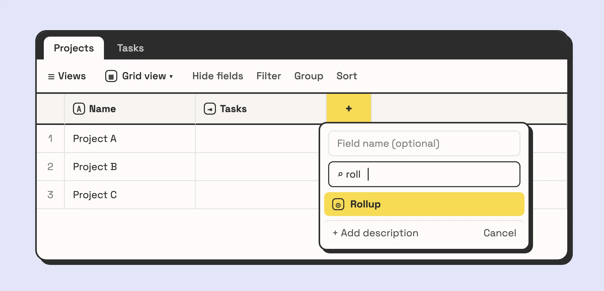
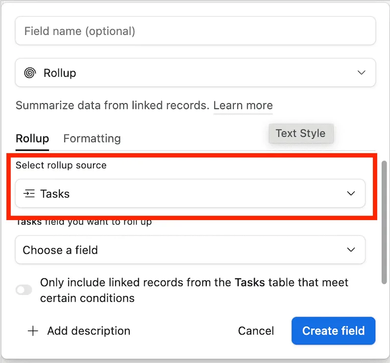
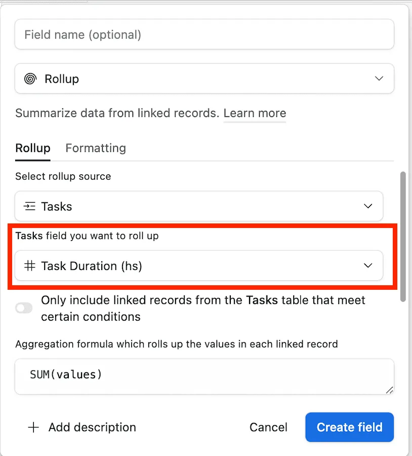
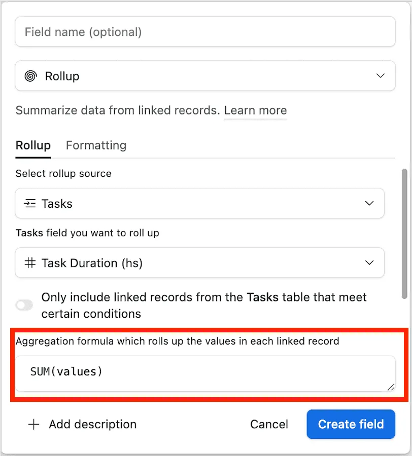
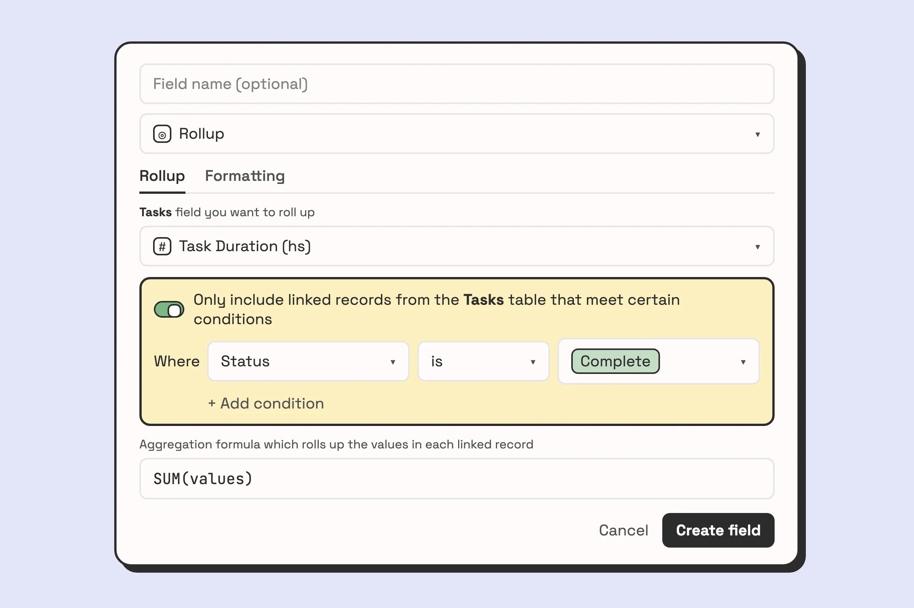
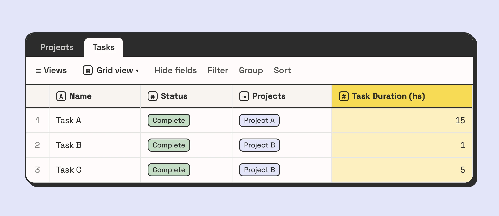
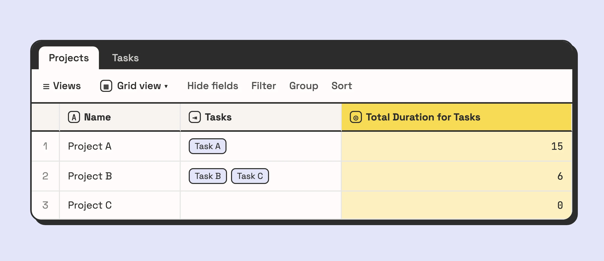

You have a Projects table linked to a Tasks table, and you want each project to show its total hours. An Airtable rollup does that. It reads one field from every linked record, runs a formula over those values, and puts the answer on the parent record. When a task changes, the total changes with it.

The setup takes a minute. Picking the formula takes a little longer. The mistakes show up weeks later, in a report that says 0 when the honest answer is "we don't know".

## The Airtable rollup setup, in one line

Link field, then the field to read, then an aggregation formula. For total hours per project: link **Tasks**, roll up **Task Duration**, formula `SUM(values)`.

Step by step:

1. **Make sure the tables are linked.** A rollup can only read from a table your current table already links to. If Projects has no "Link to another record" field pointing at Tasks, the rollup has nothing to read.
2. **Add a field and choose Rollup.** Click "+" at the end of the table and search for it.
   
3. **Pick the link field.** This decides which table the values come from.
   
4. **Pick the field to roll up.** Here, Task Duration in hours.
   
5. **Write the aggregation formula.** `values` stands for the list of values pulled from the linked records.
   
6. **Add conditions if you need them.** Switch on "Only include linked records that meet certain conditions" to, for example, sum only tasks whose Status is Complete. Conditions work like view filters: a field, an operator, a value.
   
7. **Save.** Every project now carries its own total.





Look at Project C in that last screenshot. It has no tasks linked at all, and the rollup says 0. That is the second failure below.

View filters do not touch a rollup, which surprises people. If you hide cancelled tasks in the Tasks grid, the rollup still counts them. Only the conditions inside the field configuration decide which linked records are included.

## The rollup formulas worth knowing, and when each is wrong

Airtable accepts a fixed set of aggregation functions in the rollup formula box. Each of the common ones has a case where it gives you a confident, wrong number.

| Formula | What it returns | When it is wrong |
|---|---|---|
| `SUM(values)` | The total of the values | The field is text, or nothing is linked. You get 0 either way |
| `AVERAGE(values)` | The mean of the values | The records are not equal weight. The average of five order margins is not the margin across those five orders |
| `COUNTALL(values)` | The number of linked records, blanks included | You wanted records that have a value. Use `COUNTA` |
| `COUNTA(values)` | The number of non-empty values, text or number | You wanted numbers only. Use `COUNT` |
| `COUNT(values)` | The number of non-empty numeric values | The field is text, so nothing gets counted |
| `MAX(values)` / `MIN(values)` | The largest or smallest number | You need to know which record it came from. It returns the number only |
| `ARRAYJOIN(values, ", ")` | The values as one text string | You then try to do maths on it. It is text now |
| `ARRAYUNIQUE(values)` | The values with duplicates removed | You roll up a multiple select field. It compares whole groups of options, so "A, B" and "A" both survive |
| `AND(values)` | True if every value is true | Nothing is linked. Airtable treats an empty list as true, so a project with no approvals linked reads as fully approved |

The three COUNT functions cause the most confusion. `COUNTALL` counts linked records. `COUNTA` counts linked records that have something in the field. `COUNT` counts linked records that have a number in the field. Put `COUNTALL` and `COUNTA` side by side on the same link, and the gap between them is the number of linked records with that field left blank.

If `COUNTALL(values)` is the whole formula, you probably do not need a rollup. The Count field does exactly that, with the same conditions option.

## Three ways rollups break in real bases

These are the rollup problems we fix most often in bases we are handed. None of them throws an error. Each one produces a number that looks fine.

### 1. The rollup that should have been a formula

The first sign is a rollup counting something that already has a purpose-built field, or that is already sitting on the record.

The common version is `COUNTALL(values)` over a link field to show "number of tasks". It works. It is also a Count field doing a rollup's impression. Use the Count field: same result, same conditions, and whoever opens the base next can tell what it does from the field type.

The other version counts something on the record itself, like how many tags are picked in a multiple select field. That needs no link and no rollup. A formula on the record does it:

```
IF({Tags}, LEN({Tags}) - LEN(SUBSTITUTE({Tags}, ",", "")) + 1, 0)
```

It counts the commas and adds one, so it miscounts if any option name contains a comma. Rename those options, or live with it.

### 2. The rollup that silently returns zero

Project C above has no tasks linked, and the rollup shows 0. On a report, 0 hours means "nobody worked on this". Here it means "nobody linked the tasks", which is a different problem with a different owner.

The same thing happens with money. A client with no invoices linked and a client whose invoices add up to nothing both show 0 in a `SUM(values)` rollup, and whoever reads the dashboard treats them as the same client.

The fix is to make "unknown" look different from "zero". It takes two fields. First, add a Count field on the Tasks link and call it **Task count**. Then add a formula field next to the rollup:

```
IF({Task count}, {Total Duration for Tasks})
```

When no tasks are linked, Task count is 0, Airtable treats 0 as false, and with no third argument the formula returns nothing, so the cell stays blank. When tasks are linked, it shows the rollup's total, including a real 0. Report on the formula field and hide the raw rollup.

Then add a view filtered to records where the link field is empty. That view is the list of missing links, and someone should own emptying it.

For blanks inside the linked records (a task linked to the project but with no duration entered), compare `COUNTALL(values)` with `COUNTA(values)` as described above.

### 3. The rollup built on a text field

`SUM(values)` over text gives you 0 or `#ERROR!`, never the total. A base usually ends up here one of two ways.

The first is a number typed into a text field. Someone stored amounts like "$1,200" in a single line text field because it looked right in the grid. Change the field type to Currency or Number, then check the converted values against the originals before you trust the rollup.

The second is a formula that returns text when you meant a number. A formula like `IF({Hours}!='', {Hours} * {Rate}, '')` mixes a number with an empty string, and Airtable outputs the whole field as text. The rollup then has nothing to add up. Leave the empty string out:

```
IF({Hours}, {Hours} * {Rate})
```

The deeper version is a value that should have been a linked record in the first place. If "Client" is a text field on your Invoices table, there is no link, so there is nothing for the Clients table to roll up. You end up with "Acme Corp" and "Acme Corp." as two clients and no way to total their spend. It is the first thing we change in a [base built from a template](/airtable-templates-why-to-use-them-where-to-find-them/), and no rollup formula can work around it.

Finding all three in one base is normal after a year of use. Fixing them means changing field types and links that views and automations already depend on, so it is careful work. If you would rather hand it over, [book a call](/book-a-call/) and we will tell you what needs repairing and what is fine as it is.

## Rollup, lookup or count: which field you need

All three read through a link field. They differ in what they do with what they read.

| You want | Use | Example |
|---|---|---|
| The linked values themselves, as they are | Lookup | Each project shows the names of its task owners |
| How many records are linked | Count | Each project shows how many tasks it has |
| One number or string calculated from the linked values | Rollup | Each project shows its total hours |
| A calculation using only this record's own fields | Formula | Each task shows hours times rate |

A [lookup field](/airtables-lookup-field-a-quick-guide/) does no maths. If you need `MAX`, `SUM` or `ARRAYUNIQUE`, you need a rollup. A [count field](/airtables-count-field-how-to-use-it-and-why-its-a-game-changer/) is the right tool whenever `COUNTALL(values)` would be the entire rollup formula. If the data you want is not behind a link at all, none of the three apply, and the [guide to field types](/airtable-field-types-a-friendly-guide-to-unlock-the-power-of-your-data/) is the better place to start.

## When a rollup means the schema is wrong

Most rollups are a sign of a healthy relational base. A few point at a problem upstream:

- A rollup over a text field that names a thing. That field should be a linked record. See failure 3.
- A rollup of a rollup of a rollup. Each layer works. Three layers usually means a table in the middle exists only to pass numbers along, and the link may belong directly on the table that holds the data.
- Several rollups on one table that all exclude the same kind of record. Those records are probably a different thing sharing the table, like orders and order lines. Split them into two tables and link them.
- A rollup column that went blank overnight. If a field used in the rollup's conditions is deleted or changes to an incompatible type, Airtable blanks the cells. Check the conditions first.

When a rollup gives a strange number, check the link field and the source field before you touch the formula.
