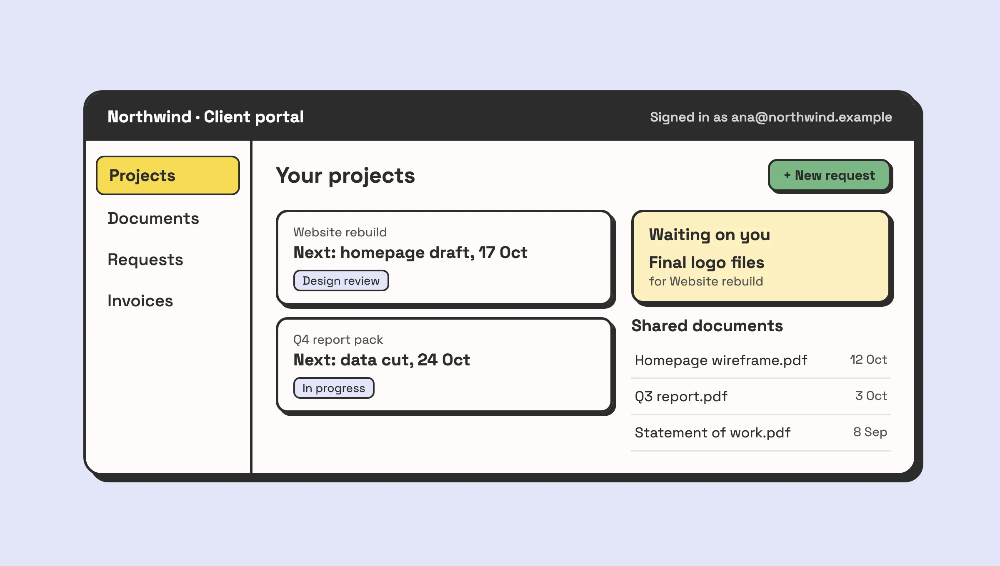
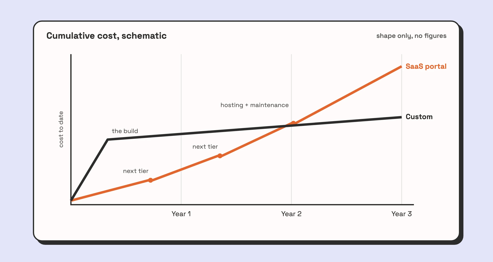

Every Monday someone on your team writes the same email to twelve clients. Here is where your project is, here is the file you asked for, we are still waiting on your logo. Half the replies ask for a file that was sent three weeks ago. So you search for client portal software, and you find thirty products that each want you to work their way.

We build client portals for service businesses, and in 2026 we almost never tell a client to buy one. A custom client portal, built around the way you already work, costs less and ships faster than most people expect, because AI-assisted development took a large share of the hand-written code out of the job. Below are the products people usually compare and where each one stops fitting, then the two paths we actually use: a no-code portal on Airtable for a quick start, and a fully custom build.

## The short answer: build the portal around your workflow

A portal is a login, a permission rule and a few screens on top of your data. The data is the valuable part: your clients, their projects, the documents and the requests going back and forth. A SaaS portal asks you to move that data into its model and pay for it every month, for as long as you have clients.

Building used to be the expensive option, so the trade made sense. Most of a portal is screens that list, show and edit records, and that part is now generated and reviewed instead of written line by line. What is left is the part that was always the real work: deciding who sees what, and connecting the portal to the systems you already run.

So there are two paths worth comparing:

- **A no-code portal on Airtable.** Your data lives in a base, and clients log into a front end built with Airtable Interfaces or Softr, with Fillout for the forms they submit. Quick to launch, cheap to change.
- **A custom client portal.** Your own application, with its own database, its own login and permissions enforced in the data. More work up front, no per-seat bill, and nothing it cannot do.

## The client portal software people compare, and where each one stops fitting

If you searched for the best client portal software, these are two of the names that come up. Each one is a reasonable product. Each one also has a point where your business starts bending to fit it.

**HubSpot customer portal.** Part of Service Hub Professional and Enterprise. Clients log in to view and reply to their support tickets and read your knowledge base. If your portal is a help desk, that fits. If clients need to see project stages, approve deliverables or download a monthly report, you are working against a tool built around tickets, and Service Hub is priced per seat for your team.

**SharePoint.** Many companies already pay for it, and guests from outside your organisation can be invited to a site without a licence of their own. It is built for documents. Permissions are set per site, library, folder or file, which gets hard to audit with fifty clients, and when you share one folder with several guests they can see each other's names in its access panel. SharePoint works as a client portal for file exchange. Anything with a workflow needs Power Automate and someone who maintains it.

The pattern is the same for both. The product decides what a client, a project and a request are. When yours are different, you either change your process or keep a spreadsheet next to the portal, and the spreadsheet is where the client emails come from.

## What AI changed about building custom software, and what it did not

What got faster is the predictable code. A list of projects filtered to the logged-in client, a project detail page, an upload form, a request form with validation, the screens your own team uses to manage all of it. Login and password reset come from established libraries. In our builds, an engineer describes these screens, an AI model writes them, and the engineer reviews and corrects the result. Those screens are most of what a client portal is.

On the portal we are building now, the login, the screens that list and edit records, the client dashboard and the code that applies the permission rule took about 4 hours of work.

What did not get faster:

- The permission model. Who belongs to which client company, which roles exist, which records can be shared between clients. A model will happily write code for a rule that is wrong. Getting the rule right is a conversation with you, then careful work.
- Moving your data in. Your clients and projects live in a spreadsheet, a base or another tool, with duplicates and half-filled fields. Cleaning and migrating them is slow, and nobody should let a model do it unsupervised.
- Integrations. Your accounting system, your file storage, your CRM. Each has its own auth, limits and quirks.
- Security review. A portal shows one company's data to people outside your company. A senior engineer reads every query that touches client data before it goes live.

AI made the predictable code cheap. The list above still needs a senior engineer, and it is where a cheap portal goes wrong.

## When a no-code portal on Airtable wins

Start here when most of these are true:

- Your client data already lives in an Airtable base, or could in a week.
- Your workflow is unusual enough that no portal product models it, and it is still changing.
- Clients need to see live records (a project stage, an approval, a delivery date) rather than a static page.
- You have tens of client users rather than thousands, and one role per client company is enough.

A no-code portal is also how you find out what the portal should be. Clients use it for a few months, you see which pages they open, and if you later go custom, the base is already the specification.

## What a no-code client portal looks like inside

Most of the portals we build on Airtable sit on the same five tables.

- **Clients**: one record per client company.
- **Contacts**: one record per person who logs in, with their email, linked to a Client.
- **Projects**: linked to a Client, with the fields the client is allowed to see (stage, next delivery, what is waiting on them) next to the ones they are not (budget, margin, internal notes).
- **Documents**: attachments linked to a Project, with a "Visible to client" checkbox so drafts stay internal.
- **Requests**: what clients submit through the portal, linked to the Client and Project, with a status your team works through.

The permission rule is one sentence: a logged-in contact sees records whose Client is their Client. In Softr that is a filter on each list or detail block, matching the record's Client to the logged-in user's. In Airtable Interfaces, you invite clients as interface-only collaborators and filter pages by the current user, or use Airtable Portals, the paid add-on for guests outside your organisation. The [guide to Airtable interface examples](/best-practices-for-building-airtable-interfaces/) covers the three ways to share a page with a client and the catch in each. Requests come in through a form, and if you need conditional questions or file uploads that feel finished, [Fillout instead of Airtable's own forms](/fillout-forms-vs-airtable-forms-which-one-should-you-use-with-airtable/) is usually the better fit.

What the client sees is small on purpose:

The weak spot is where that rule lives. In a no-code portal it is a filter on each page or block, so a new page added without the filter shows every client's records. Anyone who adds a page has to know that, and someone should check each new page as a client before it goes live.

## When to build a custom client portal

These are the signals that move a project from no-code to custom. One of them can be enough.

- Each client sees your logo on your domain, or the portal is white-labelled per client.
- The client company needs more than one role. Their finance person sees invoices, their project lead sees deliverables, their admin manages who has access.
- Some records are shared across clients: a document or a project that two client companies both need to see, without either seeing the other's work.
- Volume: thousands of client users, or tables past the size where Airtable and Softr stay quick.
- The portal is part of what clients pay for. If they judge your service partly by the portal, it has to behave like a product.
- Clients pay, sign or see outside data inside the portal: paying an invoice, signing a document, or seeing data from your accounting system without anyone copying it across.
- Per-seat pricing grows with your client list. If every new client user costs you a seat or pushes you up a tier, the bill grows with the very number you are trying to grow.

## Inside a custom client portal we are building

We are building one now, for a client who needed something no portal product and no Airtable front end could do. <!-- NEEDS: client name or business type, permission to name them, and the one thing that ruled out SaaS and no-code, in one sentence. -->

Whatever the business, a custom portal's structure comes down to the same few decisions:

- Every project, document, request and invoice row carries the company it belongs to. A user belongs to one company.
- Roles live inside a company: admin, member and billing, for example, each with its own set of screens and actions. The client's admin invites and removes their own people, so your team stops doing it by email.
- When a record has to be visible to a second company, a separate share table grants that one record to that one company.
- The rule is enforced in the database. Every query is scoped to the logged-in user's company before it returns anything, so a new screen cannot leak another client's records the way a missing filter can.
- Staff are a separate kind of user. Your team sees across clients, with its own roles, and every change a staff member makes on a client's records is logged.

On top of that sit the screens the client sees: their projects with stage and next step, what is waiting on them, their documents, their requests, and their invoices.

The app is hosted on Vercel. Supabase holds the database and handles login, and because it is Postgres underneath, the company rule can be a row level security policy that the database applies to every query, whichever screen sends it.

We fix the scope in writing before the build starts. The first version covers what a client needs to log in and see their own work: their projects, their documents, their requests, their invoices and the roles inside their company. Paying inside the portal, e-signature and extra integrations go on a written list for a later version, priced separately, once clients have used the first one and you can see what they actually ask for.

If a portal like this is on your list, [book a call](/book-a-call/). We will scope it with you, and if a no-code portal on your base would do the job, we will tell you to build that first.

## What a custom portal costs over three years, compared with a SaaS portal

Over three years, at your real client count, the two costs have different shapes.

Most SaaS portals start cheap and grow in steps. You pay per seat or per plan every month, and you climb a tier when your team or your active client contacts pass the plan's limit. The total depends on how many clients you add, which is the number you want to go up.

A custom portal costs most at the start, while it is built. After that you pay for hosting and for whoever maintains it, and that does not change much whether you have twenty client users or two thousand. The portal we are building runs on Supabase Pro, listed at [$25 a month](https://supabase.com/pricing), and Vercel Pro, listed at [$20 a month](https://vercel.com/pricing) for one developer seat. That is about $45 a month in hosting at list prices, before any usage past the plans' included limits.

Where the lines cross depends on your seat count and the size of the build. We put the build cost in a fixed quote before anything starts, so you can set it against what your seat count costs you today.

<!-- NEEDS: cost range of the build itself, and the SaaS seat or plan cost it replaced at the client's user count, to place the crossing point with real numbers. -->

## How to create a client portal: three ways in

- **Airtable Interfaces.** If your data is already in a base, build one page per client job (their projects, their documents, a request form), share it with interface-only access, and filter by the current user. Good for a handful of clients who already have Airtable accounts or for testing the idea.
- **Softr on Airtable.** A real login page, your branding, one set of pages for every client filtered to their own records, and forms writing back to the base.
- **A fixed-scope custom build.** Your own application with the permission model above. We fix the scope first, so you have the price in writing before any work starts.

If your data is not in one place yet, start there. A portal can only show what is already organised, and the [guide to building a CRM](/how-to-build-a-crm-system/) is a good way to get your clients and projects into a shape a portal can sit on.

## SaaS portal vs no-code on Airtable vs custom

| | SaaS portal | No-code on Airtable | Custom portal |
|---|---|---|---|
| Cost over 3 years | Monthly, per seat or per plan, usually rising with client users | Airtable and Softr plans, plus the build | Build up front, then hosting and maintenance |
| Time to launch | Days, if your process fits | Fast, if your data is already in a base | Fixed in the scope |
| Branding | The vendor's, with limits by plan | Your logo and colours, within the tool's options | Yours entirely |
| Permissions | The product's roles | One rule per page or block | Roles per client company, enforced in the database |
| Who owns the data | Inside the vendor's model | You, in your base | You, in your own database |
| Fits when | The product's workflow is your workflow | Your data is in Airtable and you are still learning what clients need | The portal is part of your service and has outgrown filters |

Pick the column that matches where your clients are today, and keep the data in a shape that lets you move to the next one.
