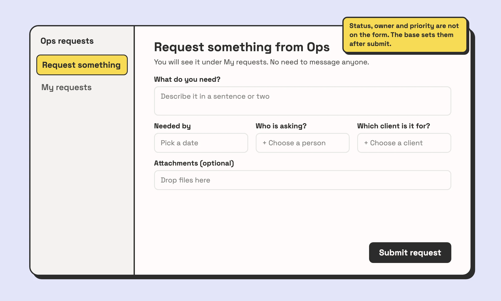
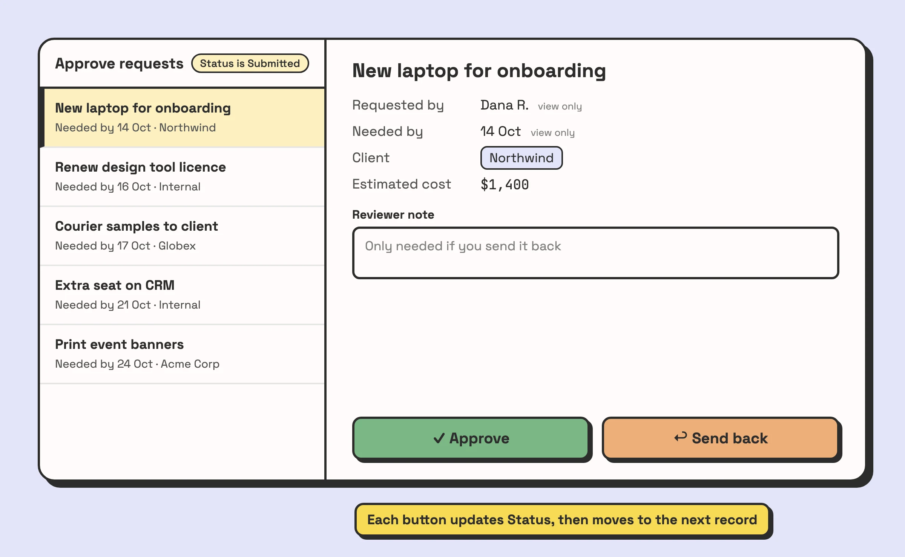
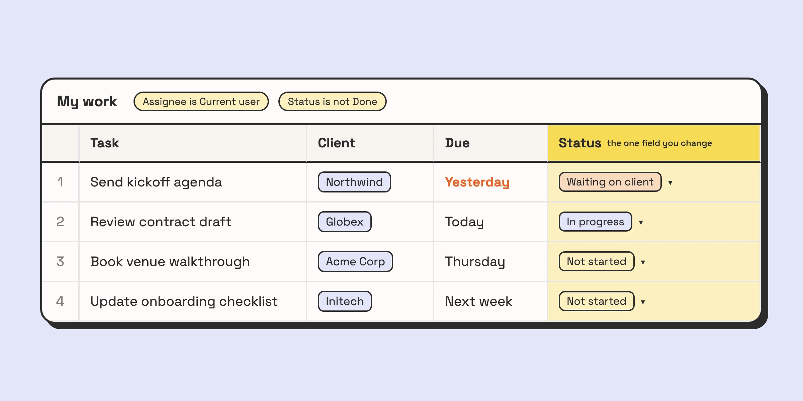
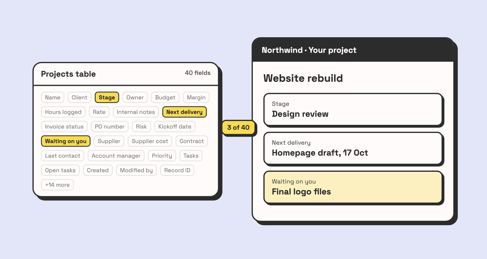
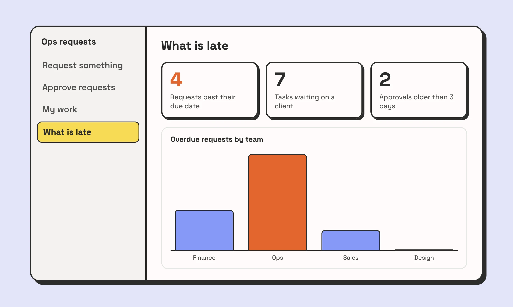

Someone builds an interface on a Friday. It has every field from the Projects table, a chart nobody asked for, and a list that opens on every record in the base. By the next Wednesday the team is back in the grid view, and the interface is a page only its builder visits.

The Airtable interface examples below went the other way. Each is built around one job for one kind of person, and shows only what that job needs. They are patterns we build for clients, drawn here with demo data, with the settings that make them work. After them come the pattern they share and the reasons teams quietly stop opening an interface.

## What an interface is for

An interface is a set of pages on top of your base, built in Interface Designer. You choose the layout, the fields, which of them can be edited, and which records appear. The data and the logic stay in the base. The interface is where people do their part of the work, and the less of the base they need to understand to do it, the better it is working.

## Five Airtable interface examples worth copying

Each one is named after the job it does, which is also the best name for the page.

### 1. Request intake: nobody needs to understand the schema

This is for anyone in the company who needs something from ops, finance or another team that runs on the base. It replaces the direct message to whoever "knows Airtable", and the request typed into a grid row with half the fields left blank.

Build it as a Form layout page on the Requests table. Put on it only the fields the requester can answer: what they need, when they need it, who is asking, and which client or project it is for, picked from a linked record list rather than typed. Attachments are optional. Requesters need editor access to the interface to submit through it.

The fields that are not on the form do as much work as the ones that are. Status, owner, priority and the request number never appear. Default values, an autonumber field and an automation fill them in, so the requester never meets a field they would have to guess at. Add a second page, "My requests", filtered to records where the requester's user field is the current user, and people stop asking where their request went.

### 2. The review queue: built around one decision

This is for whoever approves things: a manager signing off on spend, an editor approving content, an account lead checking a quote. It replaces an email thread, or a grid view filtered to "Submitted" where the approver has to find the right cell to change.

Use the Record review layout. The record list is filtered to `Status is Submitted`, so the queue empties as the work gets done. The record detail shows what the decision needs, every field set to view only, plus one editable field for a reviewer note.

The two buttons carry the decision. Each is an interface button with the **Update record** action: Approve sets Status to Approved, Send back sets it to Needs changes. Switch on **After update, move to next record**, and the reviewer works through the queue without touching a status field. If approving should also notify someone or create a record somewhere else, use the **Run automation** action instead, with an automation that starts from the "When a button is clicked" trigger.

### 3. My work: the page people open first thing

This is for everyone who gets assigned tasks. It replaces a shared grid view that each person filters by hand every morning, and sometimes forgets to clear.

Build a Grid or List page on the Tasks table, filtered to `Assignee is Current user` and `Status is not Done`, sorted by due date. Status is the field this job changes. In the record details, set it to editable and everything else to view only.

The current user filter is a page setting. Pick a user field, then "Current user" as the value, and each person sees their own list on the same page. The table needs a real user field, so a text field holding names will not work. The filter is also set per page, and a second page does not inherit it.

### 4. The client page: three fields out of forty

This is for a client, a contractor or a partner outside your company. It replaces the weekly status email somebody writes by copying values out of the base.

Your Projects table probably holds the budget, the margin, internal notes and a supplier cost. The client needs the stage, the next delivery, and what is waiting on them. Build a Record detail or List page that shows those three fields, filtered to that client's records.

Showing it to people outside the company is the fiddly part. There are three ways, each with a catch:

- **Invite them as interface-only collaborators.** They need an Airtable account, they can't open the base, and they see only the fields you placed on the page. Check how your plan bills them before you invite twenty clients.
- **Share the page with a public link.** Nobody needs an account. A public page has no logged-in user, though, so the current user filter does not work there. Anyone with the link sees whatever the page shows, which means one page per client, filtered by hand.
- **Use Airtable Portals**, a paid add-on for sharing interfaces with guests outside your organisation, with a branded sign-in page.

If you have many clients who each log in and see only their own records, a portal tool built on top of Airtable is sometimes the better fit. When it is, we will say so instead of forcing an interface into the job.

### 5. The "what is late" dashboard

This is for the manager or founder who wants to know whether anything needs them today. It replaces asking around, or a Monday meeting spent reading statuses out loud.

Build a Dashboard page with two or three number elements: open requests past their due date, tasks waiting on a client, approvals sitting for more than a few days. Add one chart if a trend actually matters.

Someone should be able to glance at it and know where to look, and a dashboard with twelve charts fails that. The [guide to Airtable dashboards](/airtable-dashboard-guide-build-powerful-visual-data-pages/) covers the elements in more detail.

If your team still works in the grid and you want interfaces like these on your base, [book a call](/book-a-call/). We look at the base first, because an interface is only as clear as the tables under it.

## The pattern behind the ones people keep using

The five examples look different, and the settings behind them are the same:

1. One page does one job and is named after it. "Approve requests" beats "Requests". If you can't name a page with a verb, it is probably doing two jobs and should be two pages.
2. The page opens on what needs doing. The queue shows Submitted, My work hides Done, the dashboard shows what is late. A page that opens on every record makes people search, and searching is what they used the grid for.
3. View only is the default. Each field in the record details can be set to view only or editable. Leave editable the one or two fields that job changes, and nobody overwrites a date they did not mean to touch.
4. The base does the bookkeeping. Defaults, formulas and automations set statuses, owners, timestamps and request numbers. The person in the interface makes the decision, and the base records it.

Built this way, an interface needs very little training. On our builds it is one 20-minute walkthrough, because each page has one obvious thing to do.

## Why teams abandon an interface

When we audit a base, the interfaces nobody opens usually fail in one of these ways.

**It shows everything.** The builder added every field in case someone needed it. Now the field the person came for is the eleventh on the page, and the grid is faster. This is the one we see most.

**It opens on nothing to do.** A list of every record, finished ones included, gives a returning user no reason to come back. The page has to change when the work changes, and the filter is what makes it change.

**The builder never uses it.** Whoever built it lives in the grid, so nobody notices when the interface falls behind. A new status option gets added to the base, and a page filtered on the old options silently stops showing those records.

**Records seem to disappear.** Two things cause most of the confused messages. A record created on a filtered page drops off it straight away if it doesn't match the filter, for example when the user field the filter depends on was left empty. And a record with an empty title field shows up with no visible label, so people think it is missing. Both are fixed in the base: a default for the user field, and a title field that is always filled, such as a formula.

**Nobody owns it.** An interface is part of the base. When a field is renamed or a table is split, someone has to open the interface and check it. If that is nobody's job, the interface breaks one element at a time.

## When a standard form can't do the job

Forms and layouts cover most of what a team needs, up to a point. A form page creates a record in one table. Any check against other records, and any calculation, happens in the base or in an automation after the record is saved.

Past that point, Airtable lets you put your own code inside an interface. Interface Extensions are written in JavaScript or TypeScript with React, built locally with Airtable's command line tool, and added to an interface as a page of their own (the Custom layout) or as a custom element on a Dashboard page. The code reads records from the tables the builder connects to it in Interface Designer, and it can create, update and delete records in more than one of them. It runs with the permissions of whoever is using it, so a user with read-only access still can't write.

That covers the jobs a standard form can't do:

- An order form that saves the order and its line items to two tables in one submit, each line already linked to the order.
- An intake that checks the base before saving, for example warning that a client with the same email already exists instead of creating a duplicate.
- A quote builder that prices the options as the user picks them, so the total is on screen before anything is saved, not in a formula field afterwards.
- A visual picker: choosing a desk on a floor plan or a slot on a schedule, instead of scrolling a dropdown of record names.

There is a shorter route as well. Omni, Airtable's AI assistant, can generate a custom element from a description, and you can open and edit its source code afterwards.

Know the limits before you commit to code. Extensions can't store credentials for outside services securely, they don't show on mobile, and batch writes are capped at 50 records per call. Code also needs someone who can read it when Airtable changes or the process does. If a standard layout does the job, use it, because anyone on your team can change it. If what you want is a tweak to how Airtable's own screens behave rather than a new page, a browser script can sometimes do it, and we wrote up that approach in [adding custom features to Airtable](/enhancing-airtable-with-custom-features-a-practical-guide/).

## Interfaces versus giving people the base

Giving everyone base access is simpler to set up, and for a team of three who built the base together it is often the right call. An interface for three people who already know the schema is overhead.

Interfaces pay off when someone needs to do one thing in a base they did not build, and when it matters what they can see:

- **Interface-only access** lets a person open the interfaces they are invited to and nothing else. They can't open the base, and they see only the fields you placed on the pages.
- **A current user filter is not a lock** if the person also has base access. Anyone with base access can open the table and see every record. If people must see only their own records, give them interface-only access.
- **Base permissions still apply inside interfaces.** A field locked at base level stays locked on every page.

When the interfaces are fine and the base under them keeps breaking them, the base is the problem, and that is where our [Airtable consulting](/lp/airtable-consulting/) work starts.

Build the first interface for the person who complains most about the grid. Give them one page that does their one job, and see whether they open it the next morning.
