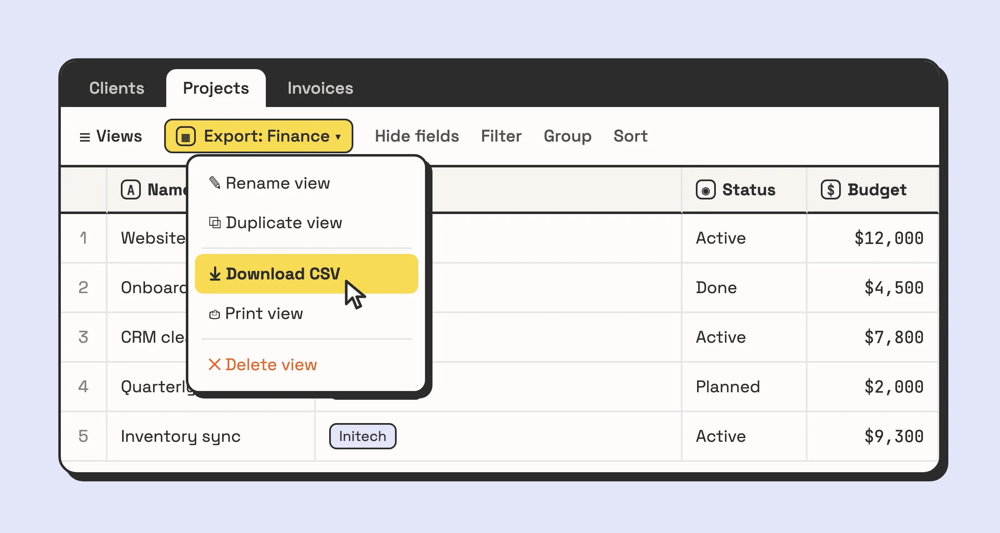
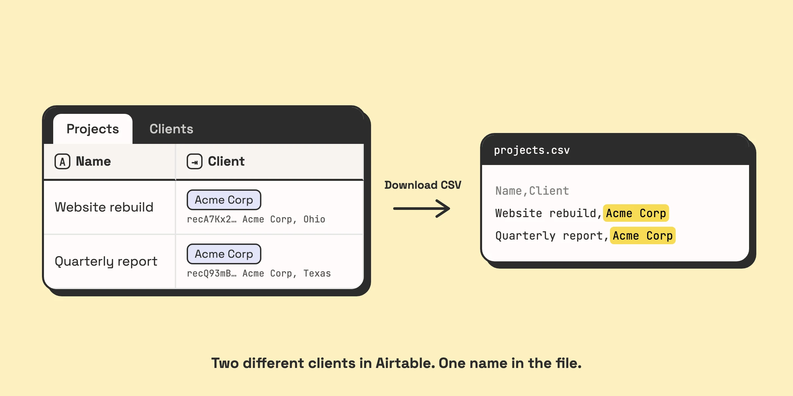
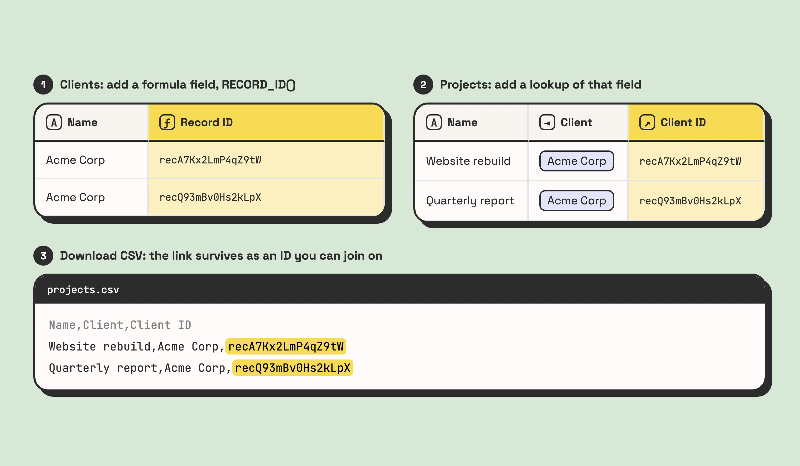

To export Airtable to Excel, open the table, switch to the grid view that shows the records and fields you want, click the arrow next to the view name and choose **Download CSV**. Open the file in Excel and save it as `.xlsx`. Airtable has no native Excel export, so the CSV is always the middle step.

That covers the mechanics. The rest of this page is about what the file leaves behind. The export is where a relational base turns back into a flat spreadsheet, and some of what made the base useful does not survive the trip.

## The three-click answer

1. **Open the grid view you want to export.** The CSV download works from grid views, in the web app and the desktop app, not on mobile.
2. **Click the down arrow next to the view name**, or right-click the view in the sidebar, and choose **Download CSV**.
3. **Open the file in Excel**, then use File > Save As and pick Excel Workbook (`.xlsx`) if you need a real workbook rather than a CSV.

If **Download CSV** is missing, you are probably in a shared view whose creator has turned off copying data out of it. That setting disables the download too. Ask whoever owns the base.

For a handful of rows there is a faster route: select the cells in the grid, copy, and paste straight into Excel. That is fine for twenty records. For anything you will need again, use the CSV.

## CSV or Excel, and when the difference matters

A CSV is plain text: one row per record, values separated by commas, no formatting and no types. Excel opens it happily, but it guesses what each column is, and on Airtable data it guesses wrong in predictable places:

- **Leading zeros disappear.** A ZIP code of `02134` or a SKU of `0045` becomes a number and loses its zeros.
- **Long numeric IDs turn into scientific notation.** A 12-digit order number can come out as `1.23457E+11`.
- **Dates are read by your computer's regional settings.** `03/04/2026` is 4 March on one laptop and 3 April on another, and nothing warns you.
- **Accented characters can come through garbled** if Excel does not read the file as UTF-8.

The fix for all four is the same. Instead of double-clicking the CSV, go to Data > From Text/CSV in Excel, set the file origin to UTF-8, click Transform Data, and set the columns that must stay text (IDs, ZIP codes, phone numbers) to Text before you load. It takes a minute longer, and you do not have to check the file by hand afterwards.

If you only need the numbers for a pivot table this week, double-clicking is fine. If the file is going to an accountant, a client or another system, import it properly.

## What the export loses, field by field

A CSV holds text, and a lot of what an Airtable base does is not text.

| Field type | What you get in the CSV | What is gone |
|---|---|---|
| Linked record | The primary field values of the linked records, comma-separated, in one cell | The link. There is no record ID, so the relationship cannot be rebuilt reliably from the file |
| Lookup and rollup | The current values | The logic. Change a source record later and the spreadsheet does not know |
| Formula | The result | The formula. Excel gets `450`, not `{Qty} * {Unit price}` |
| Attachment | A filename and a download URL | The file. The URL expires after a few hours |
| Multiple select | The selected options in one cell, separated by commas | The option list and its colours, and any easy way to filter by one option in Excel |
| Long text | The text, line breaks included, inside quotes | Nothing, as far as Excel is concerned. A script that splits the file on commas or line breaks will break these rows |

Record comments, field descriptions, the base guide, and anything an extension stores without writing it back to a field are not in the file at all.

**Linked records are the expensive one.** If a Projects table links to a Clients table, the CSV gives you the text "Acme Corp" in the Client column. It does not tell you which Acme Corp, and if two clients share a name, the file cannot tell them apart. Load it somewhere else and you have the names of things that used to be connected, without the connections.

If the relationships need to survive, add them yourself before exporting. Create a formula field in the linked table with `RECORD_ID()`, then add a lookup of that field in the table you are exporting. Every row now carries the IDs of the records it links to, and a VLOOKUP in Excel, or a script on the other end, can join them back up. [The guide to field types](/airtable-field-types-a-friendly-guide-to-unlock-the-power-of-your-data/) covers why the link is worth more than the text in the first place.

**Attachment links are not a backup.** The URLs in the CSV stop working after a few hours, and Airtable only promises at least two. A CSV saved as the archive of a table full of contracts or photos is, a week later, a list of filenames and dead links. Download the files while the links are live, or use Airtable's scripting extension to pull them in bulk.

## Exporting a view rather than a table

There is no "export base" button. The CSV comes from one view of one table, and it contains exactly what that view shows:

- **Filtered-out records are not exported.** If you want the whole table, use a view with no filters, or build one.
- **Hidden fields are not exported.** Unhide what you need, and hide what the recipient should not see.

So the view is where the cleanup happens. Build a dedicated view called something like "Export: Finance" with exactly the fields and filter the recipient needs. Next month the export is three clicks again, instead of ten minutes of hiding columns. The [step-by-step guide to exporting data from Airtable](/how-to-export-data-from-airtable-a-simple-step-by-step-guide/) walks through picking the table and view if views are new to you.

If your team works in an interface rather than the grid, the interface creator can turn on "Allow users to export data as CSV", and users then download from the **…** menu with **Download data**. Viewers still need to be logged in with at least read access to the base.

If an export like this feeds a report someone sends every week, that report is a candidate for automating. [Book a call](/book-a-call/) and we will tell you whether it is worth doing.

## If you export every week, look at what the export is for

One export is a task. The same export every Monday is a process, and it is usually one of three.

**Someone needs the data in a spreadsheet to report on it.** The report is the job, and the CSV is a manual step in the middle of it. That person is your integration layer, and when they are on holiday the report does not go out. An Airtable interface or dashboard can often show the same numbers with no file at all. When the spreadsheet really is the destination, an automation can write the rows there directly. n8n, for example, has both an Airtable node and a Microsoft Excel 365 node, so a scheduled workflow can push the records into a workbook without anyone opening Airtable.

**Another system needs the data.** The CSV is then a hand-built integration, and every run is a chance to upload last week's file by mistake. Connect the two systems instead. [What workflow automation actually is](/what-is-workflow-automation/) is the place to start if you have not done this before.

**You are backing the base up.** A weekly CSV of every table is a start, but it misses the links, the attachment files and the logic, which is most of what you would need to restore. Treat it as a copy of the data, not a backup of the base.

If you export once a quarter for your accountant, keep doing exactly that. Three clicks four times a year does not need automating. If it is weekly and the same person does it every time, ask what the export is for.
